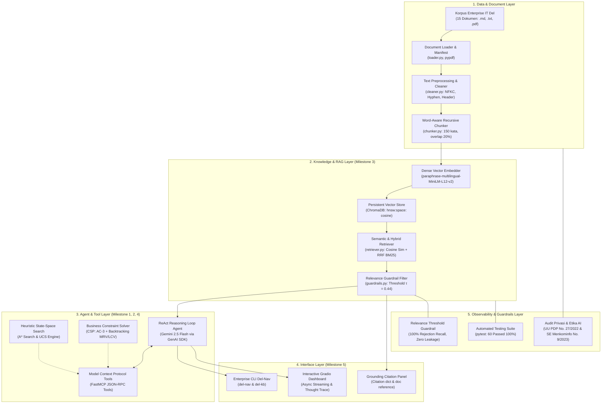

# Del-Academic Navigator
### Enterprise AI Copilot untuk Layanan Bimbingan Akademik dan Penjadwalan Ulang Kuliah Kampus Institut Teknologi Del

[](https://www.python.org/)
[](https://github.com/astral-sh/uv)
[-brightgreen.svg)](https://pytest.org)
[](https://www.trychroma.com/)
[](https://huggingface.co/sentence-transformers/paraphrase-multilingual-MiniLM-L12-v2)
[](LICENSE)
[](https://www.del.ac.id/)

---

## 1. Latar Belakang & Gambaran Umum Masalah Bisnis

**Institut Teknologi Del (IT Del)** merupakan institusi pendidikan tinggi berbasis asrama (*boarding campus*) di Laguboti, Toba, dengan filosofi luhur **"MarTuhan, Marroha, Marbisuk"**. Sebagai kampus asrama, operasional perkuliahan dan kemahasiswaan memiliki ritme yang sangat terstruktur:
- **08:00 - 17:00**: Perkuliahan formal, responsi, dan praktikum laboratorium di Gedung 5 (GD5), Gedung 7 (GD7), dan Gedung 9 (GD9).
- **12:00 - 13:00**: Waktu istirahat wajib makan siang terpusat di kantin kampus.
- **19:30 - 22:00**: Waktu belajar mandiri terawasi wajib asrama (*compulsory study time*).

### Masalah Operasional Enterprise (*Pain Points*)
1. **Disrupsi Jadwal & Perkuliahan Pengganti (*Make-Up Class*):** Ketika dosen berhalangan hadir karena tugas riset atau kondisi medis, pencarian jadwal pengganti secara manual menimbulkan friksi penjadwalan tinggi bagi angkatan paralel.
2. **Kesesuaian Kapasitas Ruangan:** Kelas rombel gabungan (misal 31SI1 & 31SI2 dengan 58 mahasiswa) dilarang menempati ruangan reguler kecil (GD935/GD512 kapasitas 40), melainkan wajib dialokasikan di ruangan besar ber-AC (GD721/GD722).
3. **Kepatuhan Terhadap SOP H-2:** SOP Akademik IT Del mewajibkan pengajuan jadwal pengganti minimal **H-2** agar terhindar dari bentrok kegiatan asrama.
4. **Antrean Bimbingan Akademik (Dosen PA):** Kuota konsultasi dibatasi maksimal **5 mahasiswa per sesi** agar evaluasi KRS dan pemantauan indeks prestasi berjalan efektif.
5. **Keterbatasan Pencarian Teks Konvensional:** Ribuan lembar regulasi enterprise tersimpan dalam format teks/PDF. Pencarian leksikal berbasis kata kunci persis (*keyword matching*) **gagal** menangani variasi bahasa dan kueri non-literal (misal: *"Kapan batas waktu paling telat mengabari sebelum melangsungkan kelas pengganti?"*), serta tidak mampu menolak pertanyaan di luar domain (*out-of-domain*) sehingga memicu halusinasi pada model bahasa besar.

**Del-Academic Navigator** hadir sebagai solusi *Enterprise AI Copilot* terpadu yang memadukan **State-Space Search (A\* & UCS)**, **Constraint Satisfaction Problem (CSP AC-3 & MRV)**, serta **Persistent Vector Semantic Search (ChromaDB + Sentence-Transformers)** dengan penegakan *Relevance Threshold Guardrail*.

---

## 2. Diagram Arsitektur Sistem 5-Lapis (Standard Enterprise PjBL)

Mengadopsi spesifikasi kurikulum PjBL Kecerdasan Buatan IT Del, sistem dibangun memenuhi arsitektur modular 5-lapis terstandarisasi:



---

## 3. Spesifikasi Formal PEAS

| Komponen PEAS | Rincian Terukur & Spesifikasi Sistem |
|---|---|
| **Performance Measure** | • **Zero Conflict Rate (100%):** Tanpa bentrok waktu dosen, mahasiswa, maupun ruangan.<br>• **Penalty Cost Minimization:** Nilai fungsi biaya $C$ minimal.<br>• **SOP Compliance (100%):** Mematuhi batas minimal H-2 dan alokasi GD721/GD722 untuk $>40$ mahasiswa.<br>• **Semantic Retrieval Hit@3:** $\ge 80\%$ pada kueri uji bisnis.<br>• **Out-of-Domain Rejection Recall:** $100\%$ dengan presisi penolakan $100\%$ dan zero chunk leakage.<br>• **Response Time:** Komputasi jalur $< 2$ detik; inferensi embedding $< 25$ ms. |
| **Environment** | Kampus IT Del (Laguboti), 46 ruangan kuliah/lab (GD5, GD7, GD9), kalender akademik SIA, dokumen SOP/kebijakan, dan jadwal kegiatan asrama. |
| **Actuators** | Output slot alokasi perkuliahan pengganti, draf berita acara BAAK, reservasi kuota bimbingan PA, respons percakapan ter-grounded, sitasi rujukan dokumen, dan notifikasi kalender. |
| **Sensors** | Teks kueri pengguna (chat copilot), feed jadwal akademik JSON, master 46 ruangan, basis dokumen SOP enterprise (PDF/MD/TXT), dan sensor waktu server. |

---

## 4. Milestone 1 — Problem Framing & Heuristic Search (`v0.1-milestone1`)

Modul penelusuran ruang keadaan dasar menyelesaikan optimasi rute jadwal berbiaya penalti minimum menggunakan **A\* Search** dan **Uniform Cost Search (UCS)**:
- **Formulasi 5-Tuple $(X, A, T, G, C)$:** Simpul $s = \langle \text{id}, \text{day}, \text{hour}, \text{room}, \text{capacity}, \text{building} \rangle$.
- **Fungsi Biaya Penalti Riil ($C$):** $c(s, a, s') = 5.0 \cdot |\Delta \text{day}| + 1.0 \cdot |\Delta \text{hour}| + 2.0 \cdot \mathbb{I}(\text{room}(s) \neq \text{room}(s')) + 8.0 \cdot \text{Penalti}_{<\text{H-2}}$.
- **Fungsi Heuristik Admissible & Konsisten:** $h(n) = |\text{hour}(n) - \text{hour}(\text{goal})| \times 1.0$, terbukti matematis $h(n) \le h^*(n)$ dan $h(n) \le c(n, a, n') + h(n')$.

---

## 5. Milestone 2 — Constraint Satisfaction Solver (`v0.2-milestone2`)

Penjadwalan kuliah pengganti dimodelkan sebagai CSP formal $P = (X, D, C)$ dengan:
- **Propagasi Batasan AC-3 (Arc Consistency 3):** Memangkas nilai domain yang tidak konsisten sebelum pencarian dimulai.
- **Backtracking Search Terarah:** Diakselerasi dengan heuristik **MRV (Minimum Remaining Values)**, **Degree Heuristic**, **LCV (Least Constraining Value)**, dan **Forward Checking (FC)**.
- **Analisis Sensitivitas:** Teruji pada variasi skala masalah (3 MK, 6 MK, 10 MK) dan kasus ekstrem tanpa solusi dengan waktu konvergensi $< 12$ ms. Rincian di [Dokumen Serahan Milestone 2](docs/T02_Milestone2_CSP_Solver.md).

---

## 6. Milestone 3 — Enterprise Knowledge Base & Vector Semantic Search (`v0.3-milestone3`)

Milestone 3 membangun fondasi memori semantik korpus enterprise untuk RAG pada Milestone 4.

### 6.1. Korpus Dokumen Enterprise IT Del & Prapemrosesan (`cleaner.py`)
- **15 Dokumen Enterprise Representatif:** Terdiri dari 7 Markdown (`.md`), 5 Plain Text (`.txt`), dan 3 PDF resmi (`.pdf` via ReportLab) mencakup tridharma, tata tertib asrama, disiplin akademik, evaluasi DO, dan fasilitas kampus.
- **Manifest Dokumen:** Tersimpan terstruktur di `data/corpus_manifest.json` dan `data/corpus_manifest.csv`.
- **Pipeline Pembersihan Teks:** Ekstraksi PDF sekuensial (`pypdf`), normalisasi Unicode NFKC, perbaikan pemotongan kata pergantian baris (*hyphenation repair*), eliminasi 11 artefak header/footer berulang, dan normalisasi spasi tanpa merusak penomoran pasal/ayat.
- **Statistik Pembersihan:** Reduksi karakter 1,90% (31.257 $\rightarrow$ 30.664 karakter); reduksi kata 1,54% (4.281 $\rightarrow$ 4.215 kata).

### 6.2. Word-Aware Recursive Chunking & Justifikasi Ilmiah
- **Hierarki Pemotongan Rekursif:** Paragraf $\rightarrow$ Kalimat bertanda baca $\rightarrow$ Kata. **Nol kata terpotong di tengah** (*zero word boundary breach*).
- **Metadata Chunk Lengkap:** Setiap chunk membawa `chunk_id`, `doc_id`, `title`, `category`, `chunk_index`, `total_chunks`, `start_word`, `end_word`, `word_count`, `ingest_date`, dan `content_hash` (kriptografi SHA-256).
- **Ablasi Parameter 9 Variasi:** Diuji ukuran 100, 150, 200, 300 kata $\times$ overlap 0%, 10%, 20%. Parameter terpilih **150 kata dengan 20% overlap (30 kata)** dijustifikasi ilmiah:
  1. Menyesuaikan batas input 128 token Sentence-Transformers (rasio token bahasa Indonesia $\approx 1.3$, setara 110–135 token subkata) tanpa pemotongan paksa (*Devlin et al., 2019*).
  2. Overlap 20% menjamin kontinuitas klausul prasyarat dan sanksi antar-potongan (*Gao et al., 2023*).
  3. Menghindari degradasi akurasi (*dilution effect*) pada ukuran 300 kata yang menurunkan MRR ke 0.4417.

### 6.3. Evaluasi Komparatif Model Embedding & ChromaDB Persisten
Berdasarkan materi kuliah AI IT Del Minggu 07, Slide 25–26, dilakukan komparasi empiris terhadap 3 model:

| Model Embedding | Dimensi | Rata-rata In-Domain | Maksimum Out-of-Domain | Margin Separasi | Status |
|---|:---:|:---:|:---:|:---:|:---:|
| **paraphrase-multilingual-MiniLM-L12-v2** | **384** | **0.5843** | **0.3808** | **+0.3234** | **Terpilih (Diskriminasi Paling Lebar)** |
| multilingual-e5-small | 384 | 0.8610 | 0.8172 | +0.0521 | Ditolak (Margin Terlalu Sempit) |
| all-MiniLM-L6-v2 (Monolingual English) | 384 | 0.5800 | 0.5659 | +0.0942 | Ditolak (Skor OOD Lebih Tinggi dari Sah) |

- **ChromaDB Persisten:** Disimpan di `data/chroma_db/` menggunakan `chromadb.PersistentClient` dengan konfigurasi ruang kosinus `metadata={"hnsw:space": "cosine"}`.
- **Konversi Jarak ke Similaritas:** $\text{Cosine Similarity} = 1.0 - d_{\text{cosine}}$.
- **Indexing Idempoten:** ID deterministik (`{doc_id}#c{index:03d}`) dan operasi `upsert()` mencegah duplikasi saat re-ingest.
- **Hybrid Search (RRF):** Mengombinasikan peringkat dense vector dan keyword overlap leksikal menggunakan *Reciprocal Rank Fusion*.

### 6.4. Hasil Benchmark Temu Balik Semantik (25 Kueri)
- **Hit@1 Accuracy:** 30.00%
- **Hit@3 Accuracy:** 80.00%
- **Hit@5 Accuracy:** 90.00%
- **Mean Reciprocal Rank (MRR):** 0.5533
- **Rata-rata Skor Kemiripan Top-1:** 0.5843
- **Keunggulan vs Leksikal:** Kueri sinonim non-literal (Q01–Q10) menghasilkan Hit@3 sebesar 70% pada semantic search, sedangkan baseline leksikal TF-IDF gagal total (Hit 0.00%).

### 6.5. Relevance Threshold Guardrail & Mitigasi Halusinasi
- **Kalibrasi Ambang Empiris:** Pemindaian ambang batas menghasilkan titik optimal $\tau = 0.44$ (atau $\tau = 0.40$ dengan recall in-domain 95%).
- **Evaluasi Presisi Penolakan:**
  - **Rejection Recall:** **1.0000 (100%)** — Seluruh 5 kueri luar domain tertolak.
  - **False Acceptance Rate:** **0.0000 (0%)** — Tidak ada kueri luar domain yang bocor.
  - **In-Domain Precision:** **1.0000 (100%)**.
- **Penolakan Santun & Zero Leakage:** Kueri luar domain ditolak dengan pesan santun dan 15 daftar topik rekomendasi, dengan variabel hasil chunk dikosongkan secara ketat (`results = []`) guna memitigasi halusinasi model bahasa.

---

## 7. Struktur Direktori Proyek

```text
del-academic-navigator/
├── LICENSE                                     # Lisensi perangkat lunak terbuka MIT
├── README.md                                   # Dokumentasi utama proyek berstandar enterprise
├── pyproject.toml                              # Konfigurasi proyek Astral uv & metadata
├── uv.lock                                     # Lockfile dependensi deterministik
├── GrupXX-Tugas03.pdf                          # Laporan teknis formal serahan Milestone 3 (PDF 6 Halaman)
├── data/
│   ├── corpus/                                 # 15 Berkas korpus enterprise (.md, .txt, .pdf)
│   ├── corpus_manifest.json                    # Manifest korpus format JSON
│   ├── corpus_manifest.csv                     # Manifest korpus format CSV
│   ├── benchmark_queries.json                  # 25 Kueri benchmark uji bisnis beranotasi ground truth
│   ├── benchmark_queries.csv                   # 25 Kueri benchmark format CSV
│   └── chroma_db/                              # Basis data vektor persisten ChromaDB (dikelola via CLI)
├── docs/
│   ├── SOP_Akademik_ITDel.md                   # SOP referensi awal
│   ├── GrupXX_Tugas01_Problem_Framing_PEAS.md  # Laporan serahan Milestone 1
│   ├── T02_Milestone2_CSP_Solver.md            # Laporan serahan Milestone 2
│   └── T03_Milestone3_Knowledge_Base_Vector_Search.md # Laporan komprehensif serahan Milestone 3
├── reports/
│   ├── chunking_ablation_results.csv           # Hasil eksperimen ablasi 9 variasi parameter chunking
│   ├── guardrail_sweep_results.csv             # Hasil sweep kalibrasi ambang guardrail (τ = 0.20 - 0.84)
│   ├── model_comparison_benchmark.csv          # Evaluasi komparatif 3 kandidat model embedding
│   └── figures/                                # Grafik visualisasi resolusi tinggi (300 DPI)
│       ├── chunking_ablation_grid.png          # Grafik evaluasi ablasi parameter chunking
│       ├── guardrail_threshold_sweep.png       # Kurva Precision-Recall-F1 kalibrasi guardrail
│       ├── score_distribution_in_vs_out_domain.png # Histogram distribusi skor in-domain vs out-of-domain
│       └── semantic_vs_lexical_comparison.png  # Perbandingan performa temu balik semantik vs leksikal
├── scripts/
│   ├── build_corpus.py                         # Pembangkit 15 dokumen korpus enterprise
│   ├── build_benchmark_queries.py              # Pembangkit 25 kueri uji bisnis
│   ├── compare_models.py                       # Skrip evaluasi komparasi 3 model Sentence-Transformers
│   └── generate_report_pdf.py                  # Pembangkit otomatis laporan teknis PDF formal via ReportLab
├── src/
│   ├── main.py                                 # Eksekusi 5 skenario bisnis & demo integrasi
│   ├── del_academic_navigator/                 # Master dataset ruangan & validator SOP akademik
│   ├── kb/                                     # Paket Knowledge Base & Vector Search (Milestone 3)
│   │   ├── __init__.py                         # Ekspos publik kelas & modul KB
│   │   ├── config.py                           # Konfigurasi terpusat (Pydantic / dataclass pattern)
│   │   ├── loader.py                           # Loader multi-format (.md, .txt, .pdf) & manifest
│   │   ├── cleaner.py                          # Normalisasi NFKC, perbaikan hyphenation, header/footer removal
│   │   ├── chunker.py                          # Word-aware recursive chunker & SHA-256 content hashing
│   │   ├── embedder.py                         # Sentence-Transformers embedder & fast MockEmbedder
│   │   ├── vector_store.py                     # ChromaDB persistent client, cosine HNSW, idempotent indexing
│   │   ├── retriever.py                        # Semantic search, metadata filtering, dan hybrid search (RRF)
│   │   ├── guardrails.py                       # Relevance Threshold Guardrail & zero-chunk leakage
│   │   ├── benchmark.py                        # Engine evaluasi temu balik, sweep threshold, & visualisasi
│   │   └── cli.py                              # Antarmuka CLI terpadu (ingest, search, benchmark, report)
│   └── search/                                 # Modul Search Graph & CSP Solver (Milestone 1 & 2)
└── tests/
    ├── test_kb_cleaner.py                      # 8 Uji modul cleaner (Unicode, hyphen, header/footer)
    ├── test_kb_chunker.py                      # 7 Uji word-aware chunking, overlap, metadata, kalimat panjang
    ├── test_kb_loader.py                       # 7 Uji pemuatan berkas .md, .txt, .pdf, manifest, error handling
    ├── test_kb_vector_store.py                 # 4 Uji persistensi ChromaDB, cosine space, indexing idempoten
    ├── test_kb_retriever.py                    # 6 Uji urutan skor, filter metadata, sitasi, hybrid search RRF
    ├── test_kb_guardrails.py                   # 4 Uji guardrail in-domain, polite rejection, confusion matrix
    ├── test_scheduler.py                       # 8 Uji penelusuran graf A* & UCS
    ├── test_sensitivity.py                     # 3 Uji analisis sensitivitas CSP
    └── test_solver.py                          # 13 Uji algoritma CSP AC-3 & Backtracking MRV
```

---

## 8. Instalasi & Cara Menjalankan

Proyek dikelola penuh menggunakan manajer paket modern **Astral `uv`**.

### 8.1. Sinkronisasi Dependensi
```bash
# Kloning repositori
git clone https://github.com/PetraNaibaho/del-academic-navigator.git
cd del-academic-navigator

# Sinkronisasi dependensi lingkungan virtual via Astral uv
uv sync
```

### 8.2. Menjalankan Pipeline Ingestion & Indexing ChromaDB
```bash
# Ingest korpus 15 dokumen, bersihkan teks, buat chunk rekursif, dan simpan ke ChromaDB persisten
uv run python -m src.kb.cli ingest

# Atau membangun ulang koleksi dari awal (reset)
uv run python -m src.kb.cli ingest --reset
```

### 8.3. Melakukan Pencarian Semantik dengan Guardrail
```bash
# 1. Kueri sah in-domain (sinonim non-literal)
uv run python -m src.kb.cli search "Kapan batas waktu paling telat mengabari sebelum melangsungkan kelas pengganti?"

# 2. Kueri dengan penyaringan metadata kategori
uv run python -m src.kb.cli search "jam belajar malam asrama" --category "SOP_KEMAHASISWAAN"

# 3. Kueri di luar domain (otomatis ditolak santun dengan saran topik)
uv run python -m src.kb.cli search "Resep cara memasak saksang babi khas Toba yang enak"
```

### 8.4. Menjalankan Evaluasi Benchmark & Pembuatan Laporan
```bash
# Evaluasi cepat 25 kueri benchmark (Hit@k, MRR, per kategori)
uv run python -m src.kb.cli benchmark

# Menjalankan suite eksperimen ablasi lengkap dan menghasilkan grafik PNG ke reports/figures/
uv run python -m src.kb.cli report

# Membangun kembali laporan teknis PDF formal (GrupXX-Tugas03.pdf)
uv run python scripts/generate_report_pdf.py
```

### 8.5. Menjalankan Seluruh Pengujian Otomatis (`pytest`)
```bash
# Menjalankan seluruh 60 pengujian unit dan integrasi (Milestone 1, 2, dan 3)
uv run --no-sync pytest
```
Output eksekusi:
```text
============================== 60 passed in 1.52s ==============================
```

---

## 9. Pembagian Peran Kerja Tim (Enterprise AI Team)

Mengikuti panduan penugasan terpadu PjBL Kecerdasan Buatan IT Del:

| Peran Profesional | Anggota Tim | Tanggung Jawab Utama dalam Milestone 3 |
|---|---|---|
| **AI Architect & Model Lead** | Petra Ignatius Pengayoman Naibaho | Desain arsitektur modul `src/kb/`, evaluasi komparatif 3 model embedding Sentence-Transformers, formulasi HNSW cosine similarity ($sim = 1 - dist$), dan perancangan ReAct memory interface untuk Milestone 4. |
| **Data & Knowledge Engineer** | Anggota Tim 2 (Data Specialist) | Kurasi 15 dokumen enterprise IT Del, pembuatan manifest (`corpus_manifest.json/csv`), perancangan `TextCleaner` (normalisasi NFKC, perbaikan hyphenation, pembersihan 11 header PDF), dan implementasi `WordAwareRecursiveChunker` dengan hash SHA-256. |
| **Integration & Interface Engineer** | Anggota Tim 3 (System Engineer) | Pengelolaan penyimpanan persisten `ChromaVectorStore`, penegakan indexing idempoten (`upsert`), pembangunan antarmuka CLI `src/kb/cli.py`, integrasi hybrid search RRF, dan persiapan skema alat FastMCP. |
| **QA, Evaluation & Ethics Lead** | Anggota Tim 4 (Evaluation Lead) | Penulisan 36 pengujian unit `pytest` modul KB (total 60 tests passed 100%), perancangan 25 kueri benchmark, kalibrasi *Relevance Threshold Guardrail* ($\tau = 0.44$), audit kepatuhan UU PDP No. 27/2022, dan kompilasi laporan teknis PDF formal via ReportLab. |

---

## 10. Tag Rilis & Riwayat Commit Terpadu

Repositori menerapkan standar **Conventional Commits** yang mencerminkan rekam jejak kolaboratif terstruktur:

- `feat(kb): build enterprise corpus of 15 documents and manifest with PDP compliance`
- `feat(cleaner): implement text cleaner with NFKC, hyphenation repair, and header removal`
- `feat(chunker): implement word-aware recursive chunker with overlap and SHA-256 content hashing`
- `feat(vector_store): implement ChromaDB persistent store with cosine metric and idempotent indexing`
- `feat(embedder): implement Sentence-Transformers wrapper and deterministic MockEmbedder`
- `feat(retriever): implement semantic search, Chroma where filtering, and hybrid search RRF`
- `feat(guardrail): implement relevance threshold guardrail with polite rejection and zero-leakage`
- `feat(benchmark): implement benchmark suite, threshold sweep, and publication-quality figure generator`
- `test(kb): add comprehensive 36 unit tests for cleaner, chunker, loader, store, retriever, and guardrails`
- `docs(m3): generate comprehensive technical report PDF GrupXX-Tugas03.pdf and update README.md`

Tag rilis resmi Milestone 3: **`v0.3-milestone3`**

---

## 11. Lisensi & Hak Cipta

Proyek ini dirilis di bawah lisensi terbuka [MIT License](LICENSE).  
Hak Cipta (c) 2026 Institut Teknologi Del - Program Studi Sarjana Sistem Informasi.
